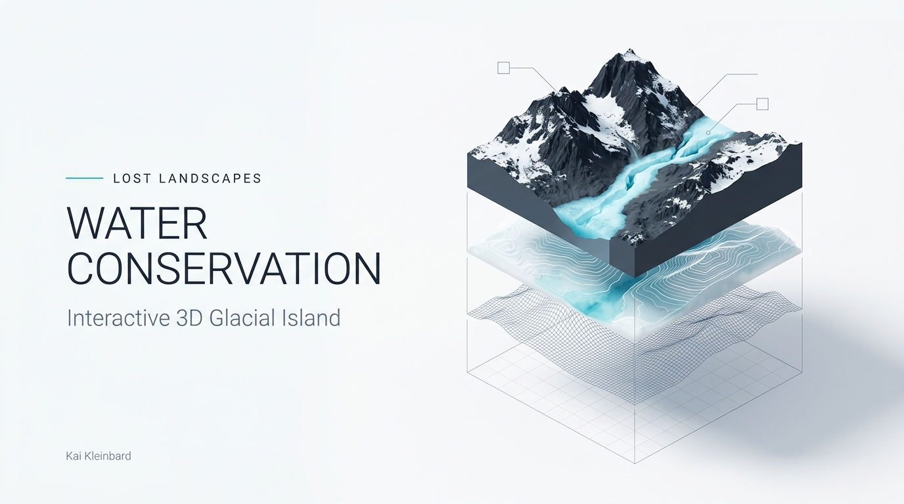

# WATER CONSERVATION — Interactive Glacial Island

**Lost Landscapes · Drawing Glaciers**  
Created by **Kai Kleinbard**

An interactive 3D procedural glacial island built with Three.js and Tone.js, featuring exploded geological strata layers, isolated terrain specimen schematics, Inception Orbit camera choreography, and generative glacial audio.

## Live Demo

Visit the published site on GitHub Pages:  
https://cre8ture.github.io/glacier/
